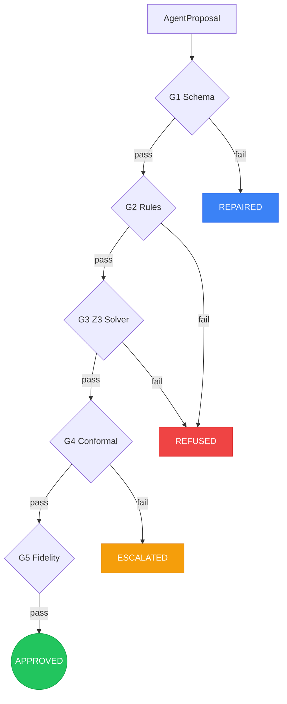

# 🛡️ TrustPort

**Port: mandatory validation for AI outputs.**

[](https://github.com/rafaelcontente/TrustPort/actions/workflows/ci.yml)
[](https://github.com/rafaelcontente/TrustPort)
[](https://www.python.org/downloads/)
[](https://github.com/Z3Prover/z3)
[](https://hypothesis.readthedocs.io/)
[](https://fastapi.tiangolo.com/)
[](https://docs.astral.sh/ruff/)
[](https://mypy-lang.org/)
[](LICENSE)
[](https://github.com/rafaelcontente/TrustPort/commits/main/)
[](https://github.com/rafaelcontente/TrustPort/pulls)

## 🎯 The Problem

An LLM will happily approve a loan it should refuse — fluently, confidently, and without checking a single rule. In credit and compliance, that confidence is a liability, not a feature. TrustPort answers one question: *can this AI proposal provably reach a human — or must it be repaired, escalated, or refused?*

## ✅ What it solves

TrustPort replaces *trust the model* with *check the proposal*. Every AI output gets a deterministic verdict — 🟢 APPROVED, 🔵 REPAIRED, 🟠 ESCALATED or 🔴 REFUSED — plus a machine-readable reason code. Refusals ship with a counterfactual the customer can act on ("reduce DSTI to ≤ 40%"), never a bare no. Measured today: **100/100 invalid proposals blocked, zero silent approvals, every refusal explained**. The agent proposes; the Port decides.

## 🚫 What this is NOT

Not a chatbot. Not a generic input validator. It is the gate between an LLM and the real world: every proposal is checked, every refusal is explained, every outcome is typed.

## ⚡ Quick Start

```bash
python3 -m venv .venv
source .venv/bin/activate
pip install -e .
make test
```

Three commands, under five minutes — 54 regression tests prove the gate holds.

## 🏗️ Architecture



One proposal, five serial gates, zero silent passes. The first gate to say no stops the run and returns a typed `PortResult`: outcome, reason code, counterfactual. 🟢 green is safe to execute, 🔵 blue goes back to the agent for repair, 🟠 amber waits for a human, 🔴 red ends with an explanation the customer can act on. Deep dive in [ARCHITECTURE.md](docs/ARCHITECTURE.md).

## 📊 Evaluation

Baseline: synthetic credit pilot — 54 regression tests, all green. Only measured numbers appear here; no aspirational metrics.

- 🚫 **100/100** invalid proposals blocked, zero slipped through as APPROVED (REG-001).
- 💬 **100%** of refusals ship with an actionable counterfactual, not just a no (REG-003, REG-007).
- 🎯 **Conformal coverage ~90%** on held-out test set (REG-006).
- ⚡ **<5ms p50 latency**, >100 req/s throughput (REG-011).

Full tables and methodology live in [EVALUATION.md](docs/EVALUATION.md).

## ⚠️ Limitations

Honesty over hype — what is done and what is not:

- ✅ **G3 (Z3 Solver):** Enforces formal constraints (e.g., high amount requires long term, max term bounds). Proven in REG-005, REG-018.
- ✅ **G4 (Conformal):** Split Conformal Prediction engine with drift detection and segmented coverage validation (REG-006, REG-022). Live routing still uses heuristic proxy pending trained base model.
- ✅ **Audit:** Immutable logging with chained SHA-256 hashes (REG-023).
- 📉 Calibration runs on synthetic data, not production credit portfolios.
- 🗂️ TrustPort validates; immutable persistence belongs to TrustAudit deployment layer.

Full context and evidence in [LIMITATIONS.md](docs/LIMITATIONS.md).

## 🧩 Composition

TrustPort is one gate in a larger trust layer. It speaks Pydantic contracts — `AgentProposal`, `PortResult`, `OutcomeEnum` — with **TrustAgent**, which proposes but never executes, and **TrustAudit**, which records every outcome in an append-only hash chain. Cited facts from **TrustKnowledge** feed the Gate 4 uncertainty penalty: fewer sources, wider bounds, faster escalation.

## 📚 Documentation

- 🏗️ [ARCHITECTURE.md](docs/ARCHITECTURE.md) — gates, contracts, fail-fast design
- 📊 [EVALUATION.md](docs/EVALUATION.md) — benchmarks and methodology
- ⚠️ [LIMITATIONS.md](docs/LIMITATIONS.md) — what is proven and what is not
- 🗺️ [ROADMAP.md](docs/ROADMAP.md) — SHAP explanations, conditional conformal
- 🔌 [docs/api.md](docs/api.md) — contract reference

## 📄 License

MIT — see [LICENSE](LICENSE).

## HTTP API

TrustPort exposes a REST API with automatic OpenAPI spec.

```bash
uvicorn trust_net_port.api:app --reload   # start server
open http://localhost:8000/docs           # interactive docs
```

Endpoints: POST /validate, GET /health, GET /stats. Every decision is logged to the SQLite audit store with chained hashes.
