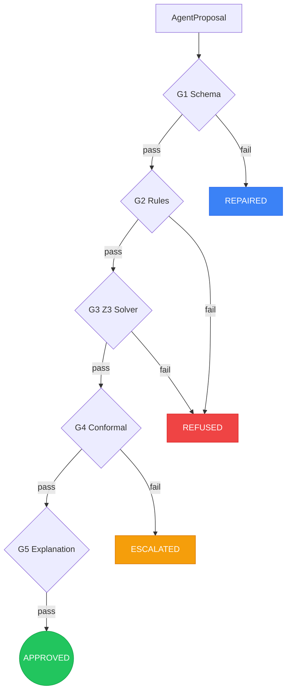

# 🛡️ TrustPort

**Port: mandatory validation for AI outputs.**

[](https://github.com/rafaelcontente/TrustPort/actions)
[](https://www.python.org/downloads/)
[](LICENSE)
[](ARCHITECTURE.md)

## 🎯 The Problem

An LLM will happily approve a loan it should refuse — fluently, confidently, and without checking a single rule. In credit and compliance, that confidence is a liability, not a feature. TrustPort answers one question: *can this AI proposal provably reach a human — or must it be repaired, escalated, or refused?*

## ✅ What it solves

TrustPort replaces *trust the model* with *check the proposal*. Every AI output gets a deterministic verdict — 🟢 APPROVED, 🔵 REPAIRED, 🟠 ESCALATED or 🔴 REFUSED — plus a machine-readable reason code. Refusals ship with a counterfactual the customer can act on ("reduce DSTI to ≤ 40%"), never a bare no. Measured today: **100/100 invalid proposals blocked, zero silent approvals, every refusal explained**. The agent proposes; the Port decides.

## 🚫 What this is NOT

Not a chatbot. Not a generic input validator. It is the gate between an LLM and the real world: every proposal is checked, every refusal is explained, every outcome is typed.

## ⚡ Quick Start

```bash
python3 -m venv .venv && source .venv/bin/activate
pip install -e .
pytest tests/regression/port/ -v
```

Four commands, under five minutes — nine regression tests prove the gate holds.

## 🏗️ Architecture



One proposal, five serial gates, zero silent passes. The first gate to say no stops the run and returns a typed `PortResult`: outcome, reason code, counterfactual. 🟢 green is safe to execute, 🔵 blue goes back to the agent for repair, 🟠 amber waits for a human, 🔴 red ends with an explanation the customer can act on. Deep dive in [ARCHITECTURE.md](ARCHITECTURE.md).

## 📊 Evaluation

Baseline: synthetic credit pilot — 9 regression tests, all green. Only measured numbers appear here; no aspirational metrics.

- 🚫 **100/100** invalid proposals blocked, zero slipped through as APPROVED (REG-001).
- 💬 **100%** of refusals ship with an actionable counterfactual, not just a no (REG-003).
- 🎯 **ECE < 0.05** on the synthetic calibration fixture (REG-002).

Full tables and methodology live in [EVALUATION.md](EVALUATION.md).

## ⚠️ Limitations

Honesty over hype — what is not done yet:

- 🧪 G3 (SMT) and G4 (conformal) are heuristic placeholders today; real Z3 proofs and split-conformal calibration are the next milestone.
- 📉 Calibration runs on synthetic data, not production credit portfolios.
- 🗂️ TrustPort validates but never stores; immutable logging belongs to TrustAudit.

Context and mitigations in [LIMITATIONS.md](LIMITATIONS.md).

## 🧩 Composition

TrustPort is one gate in a larger trust layer. It speaks Pydantic contracts — `AgentProposal`, `PortResult`, `OutcomeEnum` — with **TrustAgent**, which proposes but never executes, and **TrustAudit**, which records every outcome in an append-only hash chain. Cited facts from **TrustKnowledge** feed the Gate 4 uncertainty penalty: fewer sources, wider bounds, faster escalation.

## 📚 Documentation

- 🏗️ [ARCHITECTURE.md](ARCHITECTURE.md) — gates, contracts, fail-fast design
- 📊 [EVALUATION.md](EVALUATION.md) — benchmarks and methodology
- ⚠️ [LIMITATIONS.md](LIMITATIONS.md) — what is not proven yet
- 🗺️ [ROADMAP.md](ROADMAP.md) — real Z3, real conformal, SHAP explanations
- 🔌 [docs/api.md](docs/api.md) — contract reference

## 📄 License

MIT — see [LICENSE](LICENSE).
