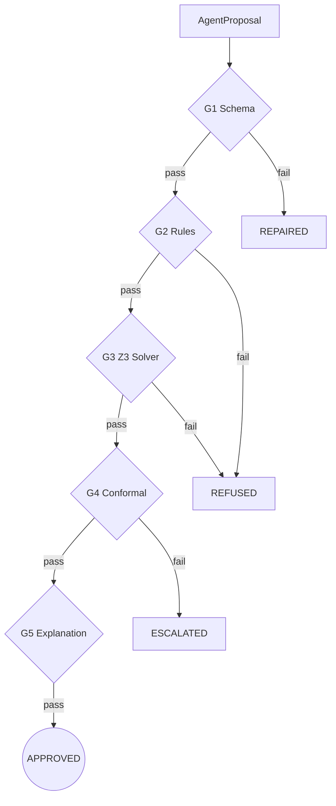

# TrustPort

Mandatory validation pipeline for AI-mediated decisions. The gate between an LLM and the real world.

[](https://github.com/rafaelcontente/TrustPort/actions)
[](https://opensource.org/licenses/MIT)
[](https://www.python.org/downloads/)

## The Problem
LLMs hallucinate, drift, and ignore deterministic rules. In high-stakes domains like credit, an unchecked AI output is a liability. TrustPort answers: *How do we mathematically and formally guarantee that an AI proposal is safe, compliant, and traceable before it reaches a human?*

## What this is NOT
It is not a chatbot, nor a generic input validator. It is the strict, deterministic gate between an autonomous agent and a user or external system.

## Quick Start

```bash
python3 -m venv .venv && source .venv/bin/activate
pip install -e .
pytest tests/regression/port/ -v
```

## Architecture



Five serial gates, fail-fast: the first gate that rejects halts the pipeline and returns a typed `PortResult` with a reason code and counterfactual. Details in [ARCHITECTURE.md](ARCHITECTURE.md).

## Evaluation

Baseline: synthetic credit pilot; 9 regression tests green (REG-001 to REG-004).

- Invalid-proposal blocking: 100/100 blocked, 0 approved (REG-001).
- Refusals with actionable counterfactual: 100% (REG-003).
- Calibration: ECE < 0.05 on the synthetic calibration fixture (REG-002).

Full tables live in [EVALUATION.md](EVALUATION.md).

## Limitations

- Gate 3 (SMT) and Gate 4 (conformal) are heuristic placeholders today; real Z3 and split-conformal integration is the next milestone.
- Calibration runs on synthetic data, not production credit data.
- TrustPort validates only; immutable logging belongs to TrustAudit.

See [LIMITATIONS.md](LIMITATIONS.md).

## Composition

TrustPort shares Pydantic contracts (AgentProposal, PortResult, OutcomeEnum) with TrustAgent, which produces proposals, and TrustAudit, which records every outcome. Cited facts from TrustKnowledge feed the Gate 4 uncertainty penalty.

## Documentation

- [ARCHITECTURE.md](ARCHITECTURE.md)
- [EVALUATION.md](EVALUATION.md)
- [LIMITATIONS.md](LIMITATIONS.md)
- [ROADMAP.md](ROADMAP.md)
- [docs/api.md](docs/api.md)

## License

MIT. See [LICENSE](LICENSE).
